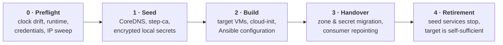

# Genesis User Guide

This guide walks you through building, configuring, deploying, and operating an automated, self-sufficient infrastructure foundation using **Genesis**.

---

## Table of Contents

1. [Overview](#1-overview)
2. [Prerequisites](#2-prerequisites)
3. [Building the CLI](#3-building-the-cli)
4. [Step-by-Step Walkthrough](#4-step-by-step-walkthrough)
   - [Step 1: Initialize the Seed (`genesis init`)](#step-1-initialize-the-seed-genesis-init)
   - [Step 2: Write an Environment Specification (`spec.yaml`)](#step-2-write-an-environment-specification-specyaml)
   - [Step 3: Validate the Specification (`genesis validate`)](#step-3-validate-the-specification-genesis-validate)
   - [Step 4: Inspect the Execution Plan (`genesis plan`)](#step-4-inspect-the-execution-plan-genesis-plan)
   - [Step 5: Apply the Specification (`genesis apply`)](#step-5-apply-the-specification-genesis-apply)
   - [Step 6: Inspect Environment Status (`genesis status`)](#step-6-inspect-environment-status-genesis-status)
   - [Step 7: Retrieve Generated Secrets (`genesis secrets`)](#step-7-retrieve-generated-secrets-genesis-secrets)
   - [Step 8: Teardown the Environment (`genesis destroy`)](#step-8-teardown-the-environment-genesis-destroy)
5. [Seed Retirement & Backup](#5-seed-retirement--backup)
6. [Managing Modules (`genesis modules`)](#6-managing-modules-genesis-modules)
7. [Troubleshooting & Recovery](#7-troubleshooting--recovery)

---

## 1. Overview

Genesis builds complete virtualized foundations—including NTP, DNS, PKI, secrets storage, and SSH bastion access—from a single declarative YAML file describing **capabilities** rather than low-level recipes.

Genesis operates in five distinct lifecycle phases:



1. **Preflight**: Verifies host clock synchronization, container runtime availability, IP pool availability, and hypervisor API access.
2. **Seed**: Launches ephemeral containers (CoreDNS for temporary DNS resolution, step-ca for initial TLS certificates, and local age-encrypted secret storage).
3. **Build**: Uses the hypervisor (e.g. Proxmox VE or simulated containers) to provision target virtual machines in dependency order, injecting cloud-init configuration and running Ansible playbooks.
4. **Handover**: Migrates DNS zones to the target DNS (PowerDNS), shifts PKI and secret management to HashiCorp Vault, reissues certificates, and updates consumers dynamically.
5. **Retirement**: Once all services are fully verified in target configuration, the seed stops its temporary containers and steps aside, leaving behind a self-sufficient foundation.

---

## 2. Prerequisites

### Host Environment (The Seed)
The machine running `genesis` (the seed) can be a physical server, VM, or local workstation:
- **Operating System**: Linux (recommended: Debian 12+, Ubuntu 22.04+) or macOS (darwin/arm64 or darwin/amd64).
- **Go Toolchain**: Go 1.27 or later (specified in [`go.mod`](../go.mod)).
- **Container Runtime**: Docker (24.0+) or Podman (4.0+). The runtime daemon must be active and accessible without `sudo` by the user running Genesis. The seed uses containers for CoreDNS, step-ca, and running isolated Ansible playbooks.
- **Network Connectivity**:
  - Network reachability to the virtualization hypervisor (e.g. Proxmox VE API on port 8006).
  - Outbound Internet connectivity to pull container images and OS packages (connected profile).
  - IP routing to the target VM subnet.

---

## 3. Building the CLI

Clone the repository and build the binary and tool dependencies:

```bash
git clone https://github.com/WhiteRoseLK/genesis.git
cd genesis

# Install pinned build and lint tools into .bin/
make tools

# Build the genesis binary (output placed in ./bin/genesis or run via go)
go build -o ./bin/genesis ./cmd/genesis

# Verify the CLI installation
./bin/genesis --version
```

You can optionally place `./bin/genesis` in your `$PATH` (e.g. `/usr/local/bin`).

---

## 4. Step-by-Step Walkthrough

### Step 1: Initialize the Seed (`genesis init`)

The `init` command verifies seed prerequisites, creates the local state directory, and generates the master encryption key:

```bash
genesis init --state-dir /var/lib/genesis
```

Output:
```text
State directory created: /var/lib/genesis
Master key generated: /var/lib/genesis/master.key (permissions 0600)
Public key: age1...
[IMPORTANT] Back up master.key offline. Losing this key prevents decryption of recovery secrets.
```

What `genesis init` does:
- Validates the container runtime (Docker or Podman socket).
- Verifies system clock drift and NTP synchronization.
- Creates `/var/lib/genesis/state.json` initialized with an empty environment state.
- Generates an age X25519 identity in `/var/lib/genesis/master.key` with strict `0600` permissions.

---

### Step 2: Write an Environment Specification (`spec.yaml`)

Create your foundation specification file, e.g. `spec.yaml`:

```yaml
apiVersion: genesis/v1alpha1
kind: Environment
metadata:
  name: production-lab

network:
  cidr: 10.10.0.0/24
  gateway: 10.10.0.1
  pool: 10.10.0.50-10.10.0.99
  domain: lab.internal
  upstream_dns:
    - 1.1.1.1
    - 9.9.9.9
  upstream_ntp:
    - 0.pool.ntp.org
    - 1.pool.ntp.org

seed:
  address: 10.10.0.10
  state_dir: /var/lib/genesis
  container_runtime: auto

capabilities:
  compute:
    module: proxmox
    config:
      endpoint: https://pve01.home.arpa:8006
      node: pve01
      storage: local-lvm
      bridge: vmbr0
      image: debian-13
      credentials:
        token_id_ref: env://PVE_TOKEN_ID
        token_secret_ref: env://PVE_TOKEN_SECRET
  time:
    module: chrony
  dns:
    module: powerdns
  pki:
    module: vault
    config:
      root_ca:
        common_name: Lab Root CA
        validity: 10y
      default_cert_ttl: 90d
  secrets:
    module: vault
  bastion:
    module: teleport
    config:
      allowed_users:
        - admin
```

#### Secret Referencing Rules
Notice `token_id_ref` and `token_secret_ref`: **never put plaintext secrets in the spec**. Genesis supports the following reference schemas:
- `env://VARIABLE_NAME`: read from environment variables.
- `file:///path/to/secret`: read from a local file.
- `vault://path/to/secret#key`: read from a HashiCorp Vault path.

---

### Step 3: Validate the Specification (`genesis validate`)

Before executing any infrastructure changes, validate the specification syntax, IP pool calculations, and module compatibility:

```bash
genesis validate -f spec.yaml
```

The validator checks:
1. Manifest and JSON Schema compliance for the `apiVersion` and structure.
2. Network boundaries: gateway and seed addresses are outside the allocatable VM pool.
3. Module resolution: every required capability has a matching provider, and module configuration schemas match the input.

---

### Step 4: Inspect the Execution Plan (`genesis plan`)

Inspect the dependency graph, chosen modules, and execution order calculated by Kahn's topological sort:

```bash
genesis plan -f spec.yaml
```

Output highlights:
- Discovered modules in search paths.
- Resolved capability providers.
- Kahn DAG execution sequence:
  `chrony` -> `powerdns` -> `vault` -> `teleport`
- Handover mappings (`coredns` -> `powerdns`, `step-ca` -> `vault`).

---

### Step 5: Apply the Specification (`genesis apply`)

Run the full deployment:

```bash
genesis apply -f spec.yaml
```

During `apply`:
1. **Preflight**: Verifies host clock drift (< 5 seconds), tests container daemon responsiveness, verifies Proxmox credentials, and pings the IP pool to ensure no conflicts exist.
2. **Seed Phase**:
   - Launches `coredns` container to provide initial DNS.
   - Launches `step-ca` container to generate the Root CA and seed intermediate certificate.
   - Encrypts initial secret seeds (SSH host keys, tokens) to local disk.
3. **Build Phase**:
   - Provisions Chrony NTP server VM and applies base OS configuration.
   - Provisions PowerDNS server VM and configures recursor and authoritative backends.
   - Provisions HashiCorp Vault VM, bootstraps Raft cluster, unseals Vault, and configures PKI and KV engines.
   - Provisions Teleport VM, configures Auth & Proxy services, and enrols Teleport agents across target VMs.
4. **Handover Phase**:
   - PowerDNS imports initial DNS records from CoreDNS; consumers are repointed.
   - Vault reissues service TLS certificates and imports secrets from the seed file store.
   - Target nodes verify DNS and PKI resolution independently.
5. **Retirement Phase**:
   - With all target services compliant and verified, seed CoreDNS and step-ca containers are cleanly stopped.
   - The environment state is marked as `seed_retired`.

---

### Step 6: Inspect Environment Status (`genesis status`)

Check the live status of the deployment and individual module states:

```bash
genesis status -f spec.yaml
```

Output displays:
- Overall status: `COMPLIANT`
- Per-module status:
  - `chrony`: compliant (VM IP: 10.10.0.51)
  - `powerdns`: compliant (VM IP: 10.10.0.52)
  - `vault`: compliant (VM IP: 10.10.0.53)
  - `teleport`: compliant (VM IP: 10.10.0.54)
- Active function providers and seed retirement state.

---

### Step 7: Retrieve Generated Secrets (`genesis secrets`)

Genesis generates strong cryptographic keys, tokens, and certificates automatically.

#### List available secrets metadata
```bash
genesis secrets list -f spec.yaml
```

Lists entries with metadata (without printing secret values):
- `Kind`: `ssh_keypair`, `token`, `certificate`, `password`
- `Owner`: capability that created the secret
- `Consumers`: authorized capabilities
- `CreatedAt`: generation timestamp
- `Recovery`: whether the secret remains backed up locally after retirement

#### Retrieve a specific secret value
```bash
genesis secrets get -f spec.yaml pki/root-ca
genesis secrets get -f spec.yaml teleport/admin-token
```

The CLI retrieves the secret securely from Vault (or the local age-encrypted store if before handover).

---

### Step 8: Teardown the Environment (`genesis destroy`)

When an environment is no longer needed:

```bash
genesis destroy -f spec.yaml
```

The destroy command:
- Prompts for confirmation.
- Destroys virtual machines and associated resources in reverse dependency order.
- Cleans up persistent state and seed containers.

---

## 5. Seed Retirement & Backup

When `genesis apply` completes successfully, the seed steps aside:
- Temporary containers (`coredns`, `step-ca`) are stopped and removed.
- The local secret store transitions to **read-only** mode. It retains an encrypted backup copy of critical recovery secrets:
  - Root CA private key and certificate
  - Vault unseal keys and root token

### What to back up offline
Keep the following files in secure, encrypted offline storage (e.g. password manager or hardware vault):
1. `/var/lib/genesis/master.key`: The age private key required to decrypt recovery secrets.
2. `/var/lib/genesis/state.json`: The environment state and topology snapshot.
3. `/var/lib/genesis/secrets/`: The encrypted recovery secret files.

---

## 6. Managing Modules (`genesis modules`)

Genesis modules are self-contained gRPC plugin binaries.

```bash
# List all discovered modules and their provided capabilities
genesis modules list

# Scaffold a new custom module
genesis modules scaffold my-dns --provides dns.zone/v1,dns.resolver/v1

# Install an external module binary into the search path
genesis modules install ./modules/my-dns
```

For developing your own modules, see the [Module Authoring Guide](10-adding-a-module.md).

---

## 7. Troubleshooting & Recovery

### Resuming an Interrupted `apply`
If `genesis apply` fails (e.g., due to a temporary network blip or hypervisor timeout), **it is always safe to re-run**:

```bash
genesis apply -f spec.yaml
```

Genesis leverages step-level state persistence and strict idempotence:
- Steps that previously completed successfully (`STATUS_COMPLIANT`) are automatically skipped.
- Execution resumes at the first non-compliant or failed step.
- An interrupted handover leaves both seed and target services active until the handover is verified.

### Clock Drift Errors
```text
preflight check failed: host clock drift exceeds 5s
```
Genesis requires tight clock synchronization for Kerberos, TLS certificate issuance, and Raft consensus. Configure `chronyd` or `systemd-timesyncd` on the seed host before running `genesis init`.

### Container Runtime Issues
```text
failed to connect to container runtime: docker daemon not running
```
Ensure Docker or Podman is active:
```bash
sudo systemctl status docker # or podman
docker ps # test non-root socket access
```
If using Podman, ensure the rootless or system socket is exposed and `DOCKER_HOST` is set if necessary:
```bash
export DOCKER_HOST="unix:///run/user/$UID/podman/podman.sock"
```

### State File Conflicts
If multiple instances attempt to run concurrently:
```text
state directory locked by another process
```
Genesis maintains a file lock on `/var/lib/genesis/state.lock`. If a previous process crashed unexpectedly, verify no background `genesis` process is running, then clear the lock file.
